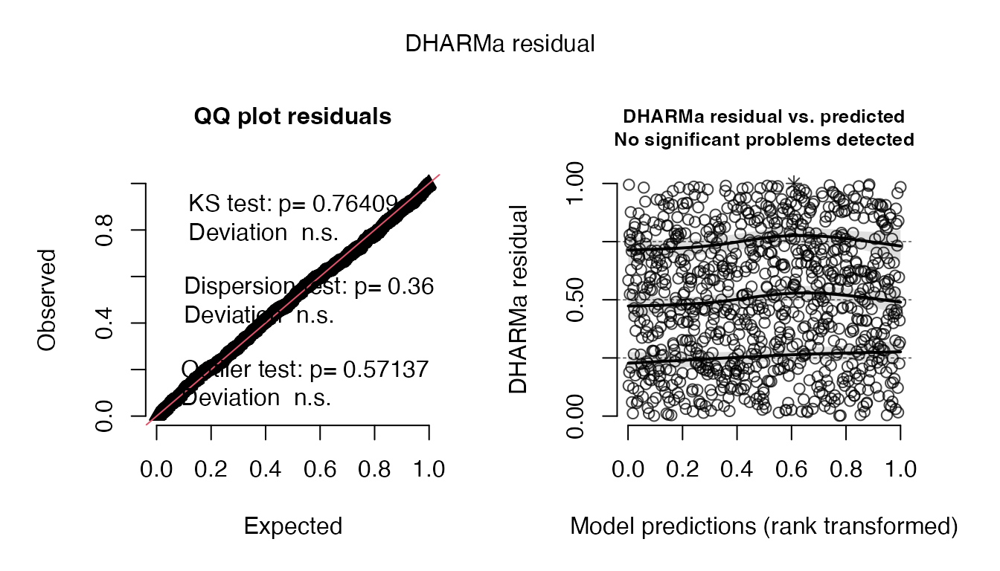

# Usage of pglmm()

The purpose of this vignette is *not* to provide detailed explanation of
model set up and results. For this purpose, please read the
documentation of
[`?phyr::pglmm`](https://daijiang.github.io/phyr/reference/pglmm.md) and
the chapter 4 of [Ives 2018](https://leanpub.com/correlateddata). The
purpose of this vignette is to show how models are fitted, what is new
in phyr 1.5.0 (large phylogenies, more families, confidence intervals,
model comparison and diagnostics) and 1.9.0 (see the next section), and
some cases that are not documented in details.

## Changes in phyr 1.9.0

phyr 1.9.0 changes a few defaults and removes old names; code written
for earlier versions mostly runs unchanged, but can give (slightly)
different results or messages:

- One engine for all models: the sparse code (`sparse = NULL`, the
  default) is now also used with covariance matrices in `cov_ranef`,
  with lists in `random.effects`, and with `bayes = TRUE` (except with
  `repulsion = TRUE`). A covariance matrix that comes from a phylogeny
  (e.g. `ape::vcv(tree)`) is converted back to the phylogeny, with a
  message suggesting to give the phylogeny itself; other matrices are
  used through their (dense) inverse. The fits are the same as those of
  the dense code (`sparse = FALSE`, kept as a reference).
- Binomial and poisson models with `random.effects` are fitted with the
  Laplace approximation by default (they were fitted by PQL): use
  `method = "PQL"` for the previous estimates.
- With `bayes = TRUE`, `ML.init = TRUE` takes its initial values from
  the fit by maximum likelihood with the sparse code (Laplace for
  binomial and poisson models), and
  [`ranef()`](https://daijiang.github.io/phyr/reference/ranef.md),
  [`predict()`](https://rdrr.io/r/stats/predict.html) with `newdata` and
  [`simulate()`](https://rdrr.io/r/stats/simulate.html) with
  `re.form = NA` work with the sparse code.
- [`pglmm()`](https://daijiang.github.io/phyr/reference/pglmm.md) shows
  a message when the variance of a random term is estimated at zero (a
  fit at the boundary, as
  [`lme4::lmer()`](https://rdrr.io/pkg/lme4/man/lmer.html));
  [`pglmm_is_singular()`](https://daijiang.github.io/phyr/reference/pglmm_is_singular.md)
  tells which terms are, and `options(phyr.boundary.message = FALSE)`
  turns the message off.
- The arguments `tree` and `tree_site` are defunct (give the phylogenies
  in `cov_ranef`);
  [`communityPGLMM()`](https://daijiang.github.io/phyr/reference/phyr-deprecated.md)
  and its helpers are deprecated (use
  [`pglmm()`](https://daijiang.github.io/phyr/reference/pglmm.md));
  `communityPGLMM.profile.LRT()`, `communityPGLMM.matrix.structure()`
  and `communityPGLMM.predicted.values()` were removed (use
  [`pglmm_profile_LRT()`](https://daijiang.github.io/phyr/reference/pglmm-profile-LRT.md),
  [`pglmm_matrix_structure()`](https://daijiang.github.io/phyr/reference/pglmm-matrix-structure.md)
  and
  [`pglmm_predicted_values()`](https://daijiang.github.io/phyr/reference/pglmm-predicted-values.md)).
- New: prior `weights`,
  [`pglmm_boot_LRT()`](https://daijiang.github.io/phyr/reference/pglmm_boot_LRT.md)
  (a parametric bootstrap test of nested models), and methods for the
  emmeans, marginaleffects and effects packages (see below).

## Families

The families of
[`pglmm()`](https://daijiang.github.io/phyr/reference/pglmm.md) (and
[`pglmm_compare()`](https://daijiang.github.io/phyr/reference/pglmm_compare.md)),
with what each supports. With `bayes = FALSE` (the default), models are
fitted by maximum likelihood (`REML = FALSE`) or restricted maximum
likelihood (`REML = TRUE`, the default); the estimates are those of the
package in the last column (checked in the tests of phyr, also for
nested phylogenetic terms such as `(1 | sp__@site)`, which those
packages fit only with the full covariance matrix of the observations).

| `family =` | Response | Link | Estimated dispersion (element of the fit) | `bayes = FALSE` | `bayes = TRUE` | Same estimates as |
|----|----|----|----|----|----|----|
| `"gaussian"` | continuous | identity | residual variance (`s2resid`) | exact likelihood | yes | [`lme4::lmer()`](https://rdrr.io/pkg/lme4/man/lmer.html), `glmmTMB()` |
| `"binomial"` | 0/1, `cbind(successes, failures)`, or proportions with the numbers of trials as `weights` | logit; probit and cloglog with `binomial(link = "probit")` and `binomial(link = "cloglog")` | none (an observation-level term is added for data with trials) | Laplace (default); PQL with `method = "PQL"` (logit only) | yes (logit) | [`lme4::glmer()`](https://rdrr.io/pkg/lme4/man/glmer.html), `glmmTMB()` |
| `"poisson"` | counts | log | none (an observation-level term is added) | Laplace (default); PQL with `method = "PQL"` | yes | [`lme4::glmer()`](https://rdrr.io/pkg/lme4/man/glmer.html), `glmmTMB()` |
| `"nbinomial"` | overdispersed counts | log | `theta` (variance `mu + mu^2 / theta`) | Laplace | yes | `glmmTMB(family = nbinom2)` |
| `"Gamma"` | positive continuous (e.g. biomass) | log | `shape` | Laplace | no | `glmmTMB(family = Gamma(link = "log"))` |
| `"betabinomial"` | overdispersed successes out of trials ([`cbind()`](https://rdrr.io/r/base/cbind.html), or proportions with `weights`) | logit | `phi` (precision) | Laplace | no | `glmmTMB(family = betabinomial())` |
| `"beta"` | proportions strictly between 0 and 1 (e.g. cover) | logit | `phi` (precision) | Laplace | no | `glmmTMB(family = beta_family())` |
| `"zeroinflated.poisson"` | counts with excess zeros | log | `zi` (probability of zero inflation, the same for all observations) | Laplace | yes | `glmmTMB(family = poisson, ziformula = ~1)` |
| `"zeroinflated.nbinomial"` | overdispersed counts with excess zeros | log | `theta`, `zi` | Laplace | yes | `glmmTMB(family = nbinom2, ziformula = ~1)` |
| `"zeroinflated.binomial"` | successes and failures with excess zeros | logit | `zi` | no | yes |  |

Notes:

- Prior `weights` divide the residual variance of gaussian models (as
  `lmer()`), are the numbers of trials of binomial and beta-binomial
  models (with proportions as response), and multiply the log-likelihood
  of each observation for the other families (as
  [`glm()`](https://rdrr.io/r/stats/glm.html) and `glmmTMB()`); with
  `bayes = TRUE`, they are available for the gaussian, binomial, poisson
  and negative binomial families.
- An observation-level random term `1|obs` is added to poisson models
  and binomial models with trials (`add.obs.re = TRUE`) to account for
  overdispersion; the families with a dispersion parameter do not need
  it. A nested term without phylogeny with one observation per
  combination of its grouping variables (e.g. `(1 | sp@site)`) is such a
  term: it replaces `1|obs`, and is dropped (with a warning) when it
  cannot be estimated (gaussian and binary data).
- For the zero-inflated families,
  [`fitted()`](https://rdrr.io/r/stats/fitted.values.html) and
  `predict(type = "response")` give the mean of the response,
  `(1 - zi) * mu`; the random terms act on the count part.
- All families take random slopes, nested terms (with `repulsion`),
  covariance matrices in `cov_ranef`, `random.effects` lists and
  [`offset()`](https://rdrr.io/r/stats/offset.html) terms, and work with
  the methods listed at the end of this vignette.

## How models are fitted

With `bayes = FALSE`, the binomial, poisson and other non-gaussian
families are fitted with the Laplace approximation of the likelihood
(see the table above for the packages with the same estimates).

Binomial and poisson models can still be fitted by penalized
quasi-likelihood with `method = "PQL"` (as in earlier versions), which
underestimates the variances of random terms for binary data and small
counts. With `bayes = TRUE`, models are fitted by INLA.

When the model has phylogenies (`cov_ranef = list(sp = phy)`),
[`pglmm()`](https://daijiang.github.io/phyr/reference/pglmm.md) uses the
sparse precision matrix of the phylogeny (including its internal nodes)
instead of the dense covariance matrix of the species (`sparse = NULL`,
the default, which is `sparse = TRUE` whenever possible). Both give the
same model, but time and memory then grow about linearly with the number
of species.

## Large phylogenies

As an example, with 5000 species at 20 sites (80,000 observations), the
binomial and poisson models `y ~ x + (1 | sp__) + (1 | site)` were
fitted by maximum likelihood in about 7 to 8 seconds each, with less
than 1 GB of memory, while `glmmTMB()` with the same model (a `propto()`
term with the phylogenetic correlation matrix) needed about 11 to 12
minutes and 12 to 13 GB, with the same estimates (see the vignette
“Performance benchmark”). Nothing special is needed for such models:

``` r

library(phyr)
nsp <- 5000
nsite <- 20
phy <- ape::rcoal(nsp, tip.label = paste0("sp", 1:nsp))
d <- expand.grid(sp = phy$tip.label, site = paste0("s", 1:nsite))
d$x <- rnorm(nrow(d))
d$y <- rbinom(nrow(d), 1, plogis(0.3 * d$x))
fit <- pglmm(y ~ x + (1 | sp__) + (1 | site), data = d, family = "binomial",
             cov_ranef = list(sp = phy))
```

On a Mac, R is several times faster with Apple’s Accelerate BLAS
library: [`pglmm()`](https://daijiang.github.io/phyr/reference/pglmm.md)
shows a message with the command to switch for large models when R uses
its reference BLAS.

## Example data

The examples below use simulated data: 60 species at 15 sites, with
phylogenetic and non-phylogenetic variation among species.

``` r

library(phyr)
set.seed(1)
nsp <- 60
nsite <- 15
phy <- ape::rcoal(nsp, tip.label = paste0("sp", 1:nsp))
d <- expand.grid(sp = phy$tip.label, site = paste0("s", 1:nsite), stringsAsFactors = FALSE)
d$x <- rnorm(nrow(d))
i <- match(d$sp, phy$tip.label)
j <- match(d$site, unique(d$site))
C <- ape::vcv(phy)
C <- C / max(diag(C))
u_phy <- as.vector(t(chol(C)) %*% rnorm(nsp, sd = 0.6))
eta <- 0.3 * d$x + u_phy[i] + rnorm(nsp, sd = 0.4)[i] + rnorm(nsite, sd = 0.5)[j]
d$y <- eta + rnorm(nrow(d))
d$effort <- runif(nrow(d), 0.5, 2)
d$count <- rnbinom(nrow(d), mu = d$effort * exp(eta), size = 2)
```

## Families and offsets

Counts with more variation than the poisson distribution can be fitted
with the negative binomial family (`"nbinomial"`, with its dispersion
`theta` estimated), and different sampling efforts with an offset:

``` r

fit_nb <- pglmm(count ~ x + offset(log(effort)) + (1 | sp__) + (1 | site),
                data = d, family = "nbinomial", cov_ranef = list(sp = phy))
fit_nb
#> Generalized linear mixed model for negative binomial data fit by Laplace approximation (restricted maximum likelihood)
#> 
#> Formula: count ~ x + offset(log(effort)) + (1 | sp__) + (1 | site)
#> 
#> logLik    AIC    BIC 
#>  -1244   2501   2529 
#> 
#> Dispersion parameter of the negative binomial distribution (theta):
#> theta 
#> 2.271 
#> 
#> Random effects:
#>        Variance Std.Dev
#> 1|sp   0.154164 0.39264
#> 1|sp__ 0.004183 0.06467
#> 1|site 0.407339 0.63823
#> 
#> Fixed effects:
#>                 Value Std.Error  Zscore    Pvalue    
#> (Intercept) -0.487636  0.294107 -1.6580   0.09731 .  
#> x            0.213111  0.039655  5.3741 7.695e-08 ***
#> ---
#> Signif. codes:  0 '***' 0.001 '**' 0.01 '*' 0.05 '.' 0.1 ' ' 1
```

Positive continuous responses (e.g. biomass) can be fitted with
`family = "Gamma"` (log link).

Prior weights are given with `weights`, as in
[`lm()`](https://rdrr.io/r/stats/lm.html) and
[`glm()`](https://rdrr.io/r/stats/glm.html): for gaussian models, the
residual variance of an observation is divided by its weight (as
[`lme4::lmer()`](https://rdrr.io/pkg/lme4/man/lmer.html)); for binomial
models, the response is a proportion and the weights are the numbers of
trials; for the other families, the weights multiply the log-likelihood
of each observation. For example, with a column `w` of weights in `d`:

``` r

pglmm(y ~ x + (1 | sp__) + (1 | site), data = d, cov_ranef = list(sp = phy), weights = w)
```

## Phylogenetic and non-phylogenetic terms

A phylogenetic term such as `(1 | sp__)` fits two terms: `1|sp__`, with
the phylogenetic covariance matrix, and `1|sp`, independent among
species (random slopes `(x | sp__)` likewise fit `x|sp__` and `x|sp`).
The variation among species is split between a part that follows the
phylogeny and a part specific to each species, and the data decide which
is more important (see the section “Phylogenetic and non-phylogenetic
terms” of
[`?pglmm`](https://daijiang.github.io/phyr/reference/pglmm.md)).

``` r

fit <- pglmm(y ~ x + (1 | sp__) + (1 | site), data = d, cov_ranef = list(sp = phy))
VarCorr(fit)
#>             Variance    Std.Dev
#> 1|sp     0.128801383 0.35888910
#> 1|sp__   0.003183415 0.05642176
#> 1|site   0.406248213 0.63737604
#> residual 1.118892231 1.05777702
```

The variances of terms with a covariance matrix are on the scale of the
matrix standardized to have a determinant of one: multiply them by
`fit$scale_factors` before comparing them with other terms. The
proportion of the variance among species that is phylogenetic, a measure
of phylogenetic signal, is then:

``` r

v <- VarCorr(fit)
v_sp <- v[c("1|sp", "1|sp__"), "Variance"] * fit$scale_factors[c("1|sp", "1|sp__")]
v_sp[2] / sum(v_sp)
#>    1|sp__ 
#> 0.4314614
```

## Confidence intervals

[`confint()`](https://rdrr.io/r/stats/confint.html) gives Wald intervals
for the fixed effects and profile likelihood intervals for the variances
(as `confint(method = "profile")` of lme4). They show how well the data
separate the phylogenetic and non-phylogenetic variances: when the two
are hard to separate, both intervals are wide, and include zero.

``` r

confint(fit)
#>                     2.5 %     97.5 %
#> (Intercept) -1.0186097565 0.03046041
#> x            0.2380503108 0.37299987
#> 1|sp         0.0645616773 0.23166368
#> 1|sp__       0.0004527303 0.01930668
#> 1|site       0.2010344149 0.97022057
#> residual     1.0174947415 1.23420671
```

## Comparing models

[`anova()`](https://rdrr.io/r/stats/anova.html) compares nested models
with likelihood ratio tests. Models with different fixed effects fitted
with `REML = TRUE` are refitted by maximum likelihood. When the models
differ by a variance, the p-value is conservative (a variance of zero is
at the boundary of its range);
[`pglmm_profile_LRT()`](https://daijiang.github.io/phyr/reference/pglmm-profile-LRT.md)
tests a random term with the p-value halved.

``` r

fit0 <- pglmm(y ~ x + (1 | sp) + (1 | site), data = d)
anova(fit0, fit)
#> fit0: y ~ x + (1 | sp) + (1 | site)
#> fit: y ~ x + (1 | sp__) + (1 | site)
#> 
#>      npar    AIC    BIC  logLik deviance  Chisq Df Pr(>Chisq)   
#> fit0    5 2792.2 2816.2 -1391.1   2782.2                        
#> fit     6 2784.4 2813.2 -1386.2   2772.4 9.8333  1   0.001714 **
#> ---
#> Signif. codes:  0 '***' 0.001 '**' 0.01 '*' 0.05 '.' 0.1 ' ' 1
pglmm_profile_LRT(fit, re.number = which(names(fit$ss) == "1|sp__"))
#> $LR
#> [1] 4.916647
#> 
#> $df
#> [1] 1
#> 
#> $Pr
#> [1] 0.000856906
```

These tests rely on the chi-square distribution of the likelihood ratio,
which can be a poor approximation with few levels of the random terms or
few effectively independent species: in simulations of binary data with
phylogenetic signal (100 species, 15 sites), the Wald test of a fixed
effect rejected a true null hypothesis in about 9% of the data sets and
the likelihood ratio test of
[`anova()`](https://rdrr.io/r/stats/anova.html) in about 11%, instead of
5% (see the vignette “Performance benchmark”).
[`pglmm_boot_LRT()`](https://daijiang.github.io/phyr/reference/pglmm_boot_LRT.md)
gives a parametric bootstrap test instead (as
[`pbkrtest::PBmodcomp()`](https://rdrr.io/pkg/pbkrtest/man/pb__modcomp.html)),
from refits of both models to responses simulated from the smaller one;
it rejected the true null hypothesis in 4% of the data sets:

``` r

fit_x0 <- pglmm(y ~ 1 + (1 | sp__) + (1 | site), data = d, cov_ranef = list(sp = phy))
pglmm_boot_LRT(fit, fit_x0, nsim = 500, seed = 1, ncores = 4)
```

## Marginal means, marginal effects and effect plots

Models fitted with `bayes = FALSE` work with the emmeans (estimated
marginal means and contrasts), marginaleffects (slopes, comparisons and
predictions averaged over the data) and effects (effect plots) packages.
They use the fixed effects and their covariance matrix, with the random
effects at zero, as for lme4 models (for marginaleffects, use
`re.form = NA` for that; by default, its predictions include the
estimated random effects). Until marginaleffects knows the class of phyr
models, set an option first:

``` r

emmeans::emmeans(fit, ~ 1, at = list(x = c(-1, 0, 1)))
options(marginaleffects_model_classes = "communityPGLMM")
marginaleffects::avg_slopes(fit_nb, variables = "x", re.form = NA)
plot(effects::Effect("x", fit_nb))
```

## Residual diagnostics

The DHARMa package calculates scaled residuals from simulations of the
fitted model ([`simulate()`](https://rdrr.io/r/stats/simulate.html)). It
warns that the class of the model is not among those it lists, but the
residuals are correct.

``` r

res <- suppressWarnings(DHARMa::simulateResiduals(fit_nb, n = 250))
plot(res)
```



## Phylogenetic uncertainty

To account for the uncertainty of the phylogeny, the model can be fitted
with several candidate trees (e.g. from the posterior distribution of a
Bayesian phylogenetic analysis) and the estimates combined with Rubin’s
rules, treating the trees as imputations of the unknown phylogeny.
[`tidy()`](https://generics.r-lib.org/reference/tidy.html) and
[`glance()`](https://generics.r-lib.org/reference/glance.html) (generics
of the broom packages) make
[`mice::pool()`](https://amices.org/mice/reference/pool.html) work with
these models:

``` r

trees <- replicate(50, ape::rcoal(nsp, tip.label = phy$tip.label), simplify = FALSE)
fits <- lapply(trees, function(tr) {
  pglmm(y ~ x + (1 | sp__) + (1 | site), data = d, cov_ranef = list(sp = tr))
})
summary(mice::pool(mice::as.mira(fits)))
```

## Fit a binomial model with success and failures

To fit a binomial model to a data frame with columns of success and
failures (say named as `yes` and `no`, respectively), use

``` r

pglmm(cbind(yes, no) ~ 1 + x, data = dat, family = 'binomial')
```

## Prepare random terms for complex models that cannot be set up with formula

Sometimes, users may want to prepare their own list of random terms to
fit phylogenetic generalized linear mixed models in more flexible ways.
For example, users may want to add an extra random term on top of those
specified by the model formula. For this, we can extract the list of
random terms generated by the model formula using
[`prep_dat_pglmm()`](https://daijiang.github.io/phyr/reference/prep_dat_pglmm.md)
and then append the one we want to add. See
[`?phyr::prep_dat_pglmm`](https://daijiang.github.io/phyr/reference/prep_dat_pglmm.md)
for details about its arguments. Since phyr 1.9.0, models with
`random.effects` are fitted with the sparse code (and binomial and
poisson models with the Laplace approximation); covariance matrices that
come from a phylogeny are converted back to it, and identical rows of a
covariance matrix of the observations (e.g. replicated observations of a
species at a site) are merged (see `random.effects` in
[`?pglmm`](https://daijiang.github.io/phyr/reference/pglmm.md)).

## Other functions to work with models fitted with `pglmm()`

All models fitted with
[`pglmm()`](https://daijiang.github.io/phyr/reference/pglmm.md) have
class of `communityPGLMM`. Here is a list of functions that can be used
with these models.

- [`summary()`](https://rdrr.io/r/base/summary.html),
  [`print()`](https://rdrr.io/r/base/print.html): summary of the fit
- [`fixef()`](https://daijiang.github.io/phyr/reference/fixef.md):
  estimates of fixed effects, with their standard errors and p-values;
  [`coef()`](https://rdrr.io/r/stats/coef.html) and
  [`vcov()`](https://rdrr.io/r/stats/vcov.html): the estimates as a
  vector and their covariance matrix
- [`ranef()`](https://daijiang.github.io/phyr/reference/ranef.md):
  estimates of each level of random terms (e.g. one value per species),
  optionally with their conditional standard deviations
  (`condVar = TRUE`)
- [`VarCorr()`](https://daijiang.github.io/phyr/reference/VarCorr.md):
  variances and standard deviations of random terms
- [`confint()`](https://rdrr.io/r/stats/confint.html): confidence
  intervals of fixed effects and variances
- [`logLik()`](https://rdrr.io/r/stats/logLik.html),
  [`AIC()`](https://rdrr.io/r/stats/AIC.html),
  [`BIC()`](https://rdrr.io/r/stats/AIC.html),
  [`anova()`](https://rdrr.io/r/stats/anova.html): log-likelihood and
  model comparison
- [`pglmm_profile_LRT()`](https://daijiang.github.io/phyr/reference/pglmm-profile-LRT.md):
  likelihood ratio test of random terms
- [`pglmm_boot_LRT()`](https://daijiang.github.io/phyr/reference/pglmm_boot_LRT.md):
  parametric bootstrap likelihood ratio test of nested models
- [`pglmm_is_singular()`](https://daijiang.github.io/phyr/reference/pglmm_is_singular.md):
  whether the fit is at the boundary (variances estimated at zero)
- [`fitted()`](https://rdrr.io/r/stats/fitted.values.html),
  [`pglmm_predicted_values()`](https://daijiang.github.io/phyr/reference/pglmm-predicted-values.md):
  fitted values
- [`predict()`](https://rdrr.io/r/stats/predict.html): predicted values,
  also for new data (`newdata`)
- [`residuals()`](https://rdrr.io/r/stats/residuals.html): residuals
- [`simulate()`](https://rdrr.io/r/stats/simulate.html): simulated
  responses (e.g. for DHARMa)
- [`update()`](https://rdrr.io/r/stats/update.html): refit with a
  changed formula or arguments
- [`tidy()`](https://generics.r-lib.org/reference/tidy.html),
  [`glance()`](https://generics.r-lib.org/reference/glance.html): data
  frames of the estimates and of the fit (broom and broom.mixed)
- [`terms()`](https://rdrr.io/r/stats/terms.html),
  [`model.matrix()`](https://rdrr.io/r/stats/model.matrix.html): terms
  and design matrix of the fixed effects; with them, the emmeans,
  marginaleffects and effects packages work with these models
- [`pglmm_iV()`](https://daijiang.github.io/phyr/reference/pglmm_iV.md):
  inverse of the covariance matrix of the observations
- [`pglmm_matrix_structure()`](https://daijiang.github.io/phyr/reference/pglmm-matrix-structure.md):
  the whole covariance matrix
- [`pglmm_plot_ranef()`](https://daijiang.github.io/phyr/reference/pglmm-plot-re.md),
  [`pglmm_plot_re()`](https://daijiang.github.io/phyr/reference/pglmm-plot-re.md):
  plot images of the covariance matrices of random terms, see the
  vignette `plot-re`
- [`plot_data()`](https://daijiang.github.io/phyr/reference/pglmm-plot-data.md):
  plot the data used (and optionally predicted) by the fitted model
- [`plot_bayes()`](https://daijiang.github.io/phyr/reference/plot_bayes.md):
  plot posterior distributions of random and fixed effects
  (`bayes = TRUE`)
