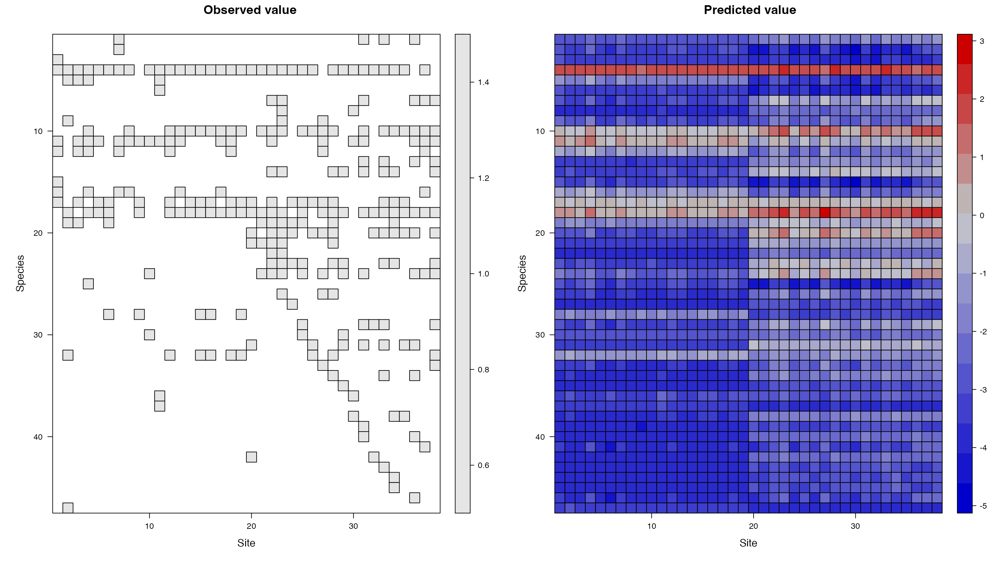
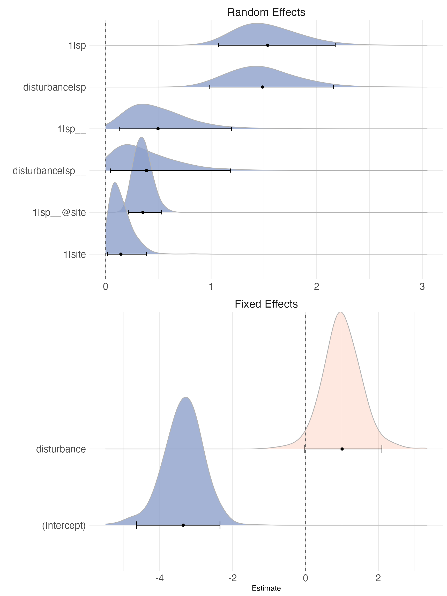
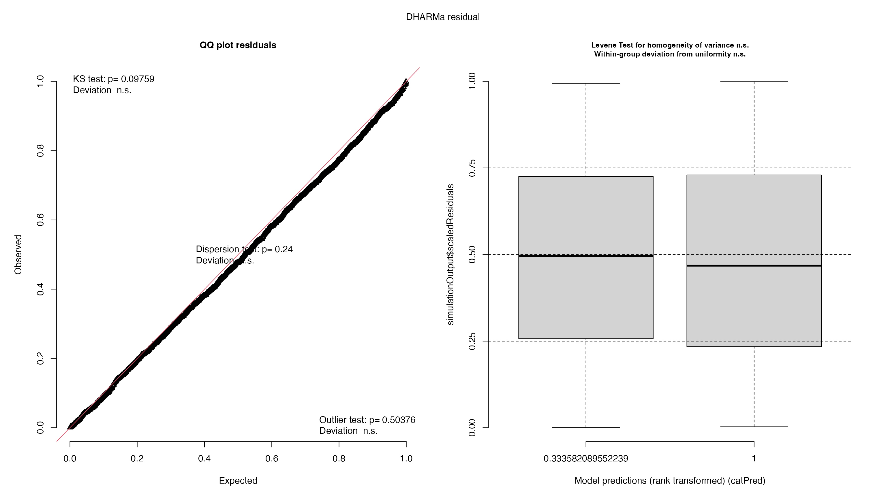
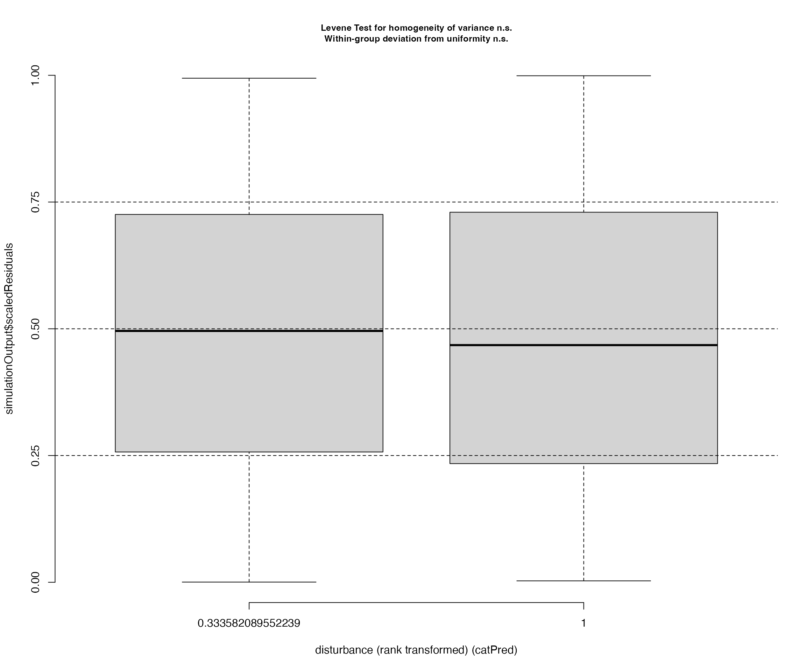
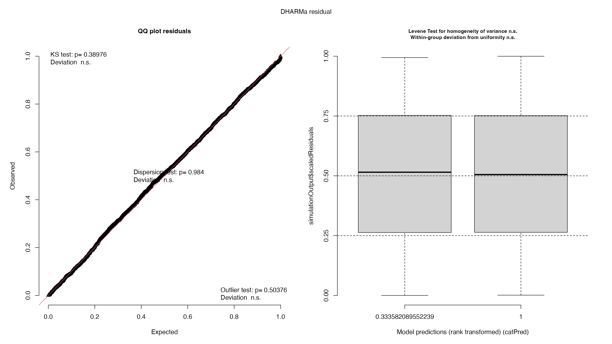

# pglmm example with empirical data

## communityPGLMM Example on Simple Empirical Dataset

This vignette will show a complete analysis example for `pglmm` on a
simple empirical dataset. The dataset is taken from [Dinnage
(2009)](https://journals.plos.org/plosone/article?id=10.1371/journal.pone.0007071).
Here we will demonstrate how to fit a PGLMM, including main phylogenetic
effects, nested phylogenetic effects, as well as including environmental
covariates. First let’s load the dataset and take a look at what we
have. The data is included in `phyr`, so we can just call
`data(oldfield)` to load it.

## Modelling Old Field Plants as a Function of Phylogeny and Disturbance

``` r

library(phyr)
library(ape)
library(dplyr)
#> 
#> Attaching package: 'dplyr'
#> The following object is masked from 'package:ape':
#> 
#>     where
#> The following objects are masked from 'package:stats':
#> 
#>     filter, lag
#> The following objects are masked from 'package:base':
#> 
#>     intersect, setdiff, setequal, union
data("oldfield")
```

The data is a list with two elements. The first element is a phylogeny
containing 47 species of plants (all herbaceous forbs) that live in old
field habitats in Southern Ontario, Canada. Oldfield habitats typically
are found in areas that were formerly cultivated but are now abandoned.
This is often considered a successional stage between farmland and
secondary forest. These data come from plots that had experienced two
“treatments”: one set of plots had been disturbed by field ploughing
within a few years of sampling, whereas the other set had not been
disturbed in this way recently. Let’s have a look at the phylogeny and
data.

``` r

plot(oldfield$phy)
```


``` r

head(oldfield$data, 40)
#> # A tibble: 40 × 7
#>    site_orig habitat_type sp            abundance disturbance site          pres
#>        <int> <chr>        <chr>             <int>       <dbl> <chr>        <int>
#>  1         1 undisturbed  Daucus_carota         0           0 1_undisturb…     0
#>  2         6 undisturbed  Daucus_carota         0           0 6_undisturb…     0
#>  3         7 undisturbed  Daucus_carota         0           0 7_undisturb…     0
#>  4         9 undisturbed  Daucus_carota         0           0 9_undisturb…     0
#>  5        10 undisturbed  Daucus_carota         0           0 10_undistur…     0
#>  6        11 undisturbed  Daucus_carota         0           0 11_undistur…     0
#>  7        13 undisturbed  Daucus_carota         1           0 13_undistur…     1
#>  8        15 undisturbed  Daucus_carota         0           0 15_undistur…     0
#>  9        16 undisturbed  Daucus_carota         0           0 16_undistur…     0
#> 10        18 undisturbed  Daucus_carota         0           0 18_undistur…     0
#> # ℹ 30 more rows
```

With these data we are interested in asking whether there is
phylogenetic structure in the distribution of these species, as well as
whether disturbance has any overall effects. To do this we will specify
two different phylogenetic effects in our `pglmm`, which uses a syntax
similar to `lmer` and `glmer` in the `lme4` package for specifying
random effects. We also include site-level random effects to account for
the paired design of the experiment. We will start by modeling just
presence and absence of species (a binomial model). Since phyr 1.4.0,
binomial models are fitted by maximum likelihood with the Laplace
approximation (`method = "Laplace"`, with the same estimates as
[`lme4::glmer()`](https://rdrr.io/pkg/lme4/man/glmer.html) and
`glmmTMB()`), using the sparse precision matrix of the phylogeny, so
this model takes about a second. This is the full model specification:

``` r

mod <- phyr::pglmm(pres ~ disturbance + (1 | sp__) + (1 | site) + 
                     (disturbance | sp__) + (1 | sp__@site), 
                   data = oldfield$data, 
                   cov_ranef = list(sp = oldfield$phy),
                   family = "binomial")
```

Here, we specified an overall phylogenetic effect using `sp__`, which
also automatically includes a nonphylogenetic i.i.d. effect of species.
`phyr` finds the linked phylogenetic data because we specified the
phylogeny in the `cov_ranef` argument, giving it the name `sp` which
matches `sp__` but without the underscores. We can include any number of
phylogenies or covariance matrices in this way, allowing us to model
multiple sources of covariance in one model. In this example, however,
we will stick to one phylogeny to cover the basics of how to run `pglmm`
models. We use the same phylogeny to model a second phylogenetic random
effect, which is specified as `sp__@site`. This is a “nested”
phylogenetic effect. This means that we are fitting an effect that had
covariance proportional to the species phylogeny, but independently for
each site (or “nested” in sites). We’ve also included a
disturbance-by-phylogenetic species effect (`(disturbance | sp__)`),
which estimates the degree to which occurrence in disturbed
vs. undisturbed habitat has a phylogenetic signal. Like the main `sp__`
effect, the disturbance-by-`sp__` effect also includes an
nonphylogenetic species-by-disturbance interaction. Let’s look at the
results:

``` r

summary(mod)
#> Generalized linear mixed model for binomial data fit by Laplace approximation (restricted maximum likelihood)
#> 
#> Formula: pres ~ disturbance + (1 | sp__) + (1 | site) + (disturbance | sp__) + (1 | sp__@site)
#> 
#> logLik    AIC    BIC 
#> -592.3 1200.7 1244.6 
#> 
#> Random effects:
#>                  Variance Std.Dev
#> 1|sp               2.8424  1.6859
#> 1|sp__             0.1286  0.3585
#> 1|site             0.0000  0.0000
#> disturbance|sp     2.8962  1.7018
#> disturbance|sp__   0.0000  0.0000
#> 1|sp__@site        0.1380  0.3714
#> 
#> Fixed effects:
#>                Value Std.Error Zscore    Pvalue    
#> (Intercept) -2.85914   0.42164 -6.781 1.194e-11 ***
#> disturbance  0.83034   0.33975  2.444   0.01453 *  
#> ---
#> Signif. codes:  0 '***' 0.001 '**' 0.01 '*' 0.05 '.' 0.1 ' ' 1
```

The results of the random effects imply that the strongest effect is an
overall nonphylogenetic species effect, followed closely by a
disturbance-by-species effect. This implies that species vary strongly
in their occurrence in disturbed or undisturbed sites, that there is a
clear community difference between these treatments. The next strongest
effect is the nested phylogenetic effect. But how can we know if this
effect is strong enough to take seriously? One way to get an idea is
with confidence intervals:
[`confint()`](https://rdrr.io/r/stats/confint.html) gives Wald intervals
for the fixed effects and profile likelihood intervals for the variances
of the random terms.

``` r

confint(mod)
#>                        2.5 %     97.5 %
#> (Intercept)      -3.68554245 -2.0327407
#> disturbance       0.16444884  1.4962393
#> 1|sp              1.19753201  5.4520904
#> 1|sp__            0.00000000  1.3707287
#> 1|site            0.00000000  0.1601013
#> disturbance|sp    0.93802655  6.0951272
#> disturbance|sp__  0.00000000  1.5595992
#> 1|sp__@site       0.04111856  0.2963340
```

The interval of the nested phylogenetic effect (`1|sp__@site`) excludes
zero, while those of the phylogenetic species effect (`1|sp__`), the
site effect and the phylogenetic disturbance-by-species effect include
it. Another way is a likelihood ratio test, comparing the model with one
without the nested term with
[`anova()`](https://rdrr.io/r/stats/anova.html):

``` r

mod0 <- update(mod, . ~ . - (1 | sp__@site))
anova(mod0, mod)
#> mod0: pres ~ disturbance + (1 | sp__) + (1 | site) + (disturbance | sp__)
#> mod: pres ~ disturbance + (1 | sp__) + (1 | site) + (disturbance | sp__) + (1 | sp__@site)
#> 
#>      npar    AIC    BIC  logLik deviance  Chisq Df Pr(>Chisq)   
#> mod0    7 1208.1 1246.5 -597.07   1194.1                        
#> mod     8 1200.7 1244.6 -592.34   1184.7 9.4538  1   0.002107 **
#> ---
#> Signif. codes:  0 '***' 0.001 '**' 0.01 '*' 0.05 '.' 0.1 ' ' 1
```

The
[`pglmm_profile_LRT()`](https://daijiang.github.io/phyr/reference/pglmm-profile-LRT.md)
function does the same test for one random term at a time, without
having to write the reduced model, and halves the p-value, as a variance
of zero is at the boundary of its range.

``` r

names(mod$ss)
#> [1] "1|sp"             "1|sp__"           "1|site"           "disturbance|sp"  
#> [5] "disturbance|sp__" "1|sp__@site"
test_nested <- phyr::pglmm_profile_LRT(mod, re.number = 6) ## sp__@site is the 6th random effect
test_nested
#> $LR
#> [1] 4.726921
#> 
#> $df
#> [1] 1
#> 
#> $Pr
#> [1] 0.001053536

# alternatively, we can test all random effects
LRTs <- sapply(1:6, FUN = function(x) phyr::pglmm_profile_LRT(mod, re.number = x))
colnames(LRTs) <- names(mod$ss)
t(LRTs)
#>                  LR           df Pr          
#> 1|sp             14.5798      1  3.332738e-08
#> 1|sp__           0.1717596    1  0.2789024   
#> 1|site           1.023182e-11 1  1           
#> disturbance|sp   4.025619     1  0.002273628 
#> disturbance|sp__ 1.023182e-11 1  1           
#> 1|sp__@site      4.726921     1  0.001053536
```

This result shows that the nested phylogenetic effect is statistically
significant. What does this mean? A model where the within-site
distributions of species are explained by the phylogenetic covariance of
species implies a ‘phylogenetic attraction’ or ‘phylogenetic clustering’
effect, in which closely related species are more likely to be found
together in the same community. In the original analysis of these data
using traditional community phylogenetics methods (null model based)
found that the disturbed sites were phylogenetically clustered but
undisturbed sites were not. If the data are split in this way, and each
split modeled separately, does this result hold up?

``` r

mod_disturbed <- phyr::pglmm(pres ~ (1 | sp__) + (1 | sp__@site) + 
                               (1 | site), 
                             data = oldfield$data %>%
                               dplyr::filter(disturbance == 1), 
                             cov_ranef = list(sp = oldfield$phy),
                             family = "binomial")

mod_undisturbed <- phyr::pglmm(pres ~ (1 | sp__) + (1 | sp__@site) + 
                                 (1 | site), 
                               data = oldfield$data %>%
                                 dplyr::filter(disturbance == 0), 
                               cov_ranef = list(sp = oldfield$phy),
                               family = "binomial")
```

``` r

cat("Disturbed phylogenetic clustering test:\n")
#> Disturbed phylogenetic clustering test:
phyr::pglmm_profile_LRT(mod_disturbed, re.number = 4)
#> $LR
#> [1] 4.460565
#> 
#> $df
#> [1] 1
#> 
#> $Pr
#> [1] 0.001409451
cat("Undisturbed phylogenetic clustering test:\n")
#> Undisturbed phylogenetic clustering test:
phyr::pglmm_profile_LRT(mod_undisturbed, re.number = 4)
#> $LR
#> [1] 0.03184089
#> 
#> $df
#> [1] 1
#> 
#> $Pr
#> [1] 0.4003843
```

Indeed! The original results hold up to this model-based test of the
same question. Whew! (╹◡╹)凸 We can also get an idea of how well the
model fits the data by plotting the observed and predicted values of the
model side-by-side.

``` r

plot_data(mod, predicted = TRUE)
```



The other result from this model is that there is a positive fixed
effect of disturbance (its Wald interval from `confint(mod)` above
excludes zero). In the context of a binomial multivariate model such as
`pglmm`, this means there is an overall increase in the probability of
occurrence in disturbed sites. In other words, disturbed sites have a
higher species richness at the site level (noting that expected alpha
species richness of a site can be expressed as Gamma richness \*
E(prob_site(occurrence))).

Another way to explore the random effects is to use the Bayesian version
of `pglmm` and then look at the shape of the posterior distribution of
our random effect variance terms.

``` r

mod_bayes <- phyr::pglmm(pres ~ disturbance + (1 | sp__) + (1 | site) + 
                     (disturbance | sp__) + (1 | sp__@site), 
                         data = oldfield$data, 
                         cov_ranef = list(sp = oldfield$phy),
                         family = "binomial",
                         bayes = TRUE,
                         prior = "pc.prior.auto")
summary(mod_bayes)
#> Generalized linear mixed model for binomial data fit by Bayesian INLA
#> 
#> Formula: pres ~ disturbance + (1 | sp__) + (1 | site) + (disturbance | sp__) + (1 | sp__@site)
#> 
#> marginal logLik             DIC            WAIC 
#>          -616.1          1097.2          1084.2 
#> 
#> Random effects:
#>                  Variance Std.Dev  lower.CI upper.CI
#> 1|sp             2.158775 1.46928 1.1493091   4.7987
#> 1|sp__           0.076716 0.27698 0.0133832   1.4354
#> 1|site           0.002358 0.04855 0.0003466   0.1736
#> disturbance|sp   1.917331 1.38468 0.9083156   4.9268
#> disturbance|sp__ 0.015930 0.12621 0.0023347   1.5256
#> 1|sp__@site      0.107109 0.32728 0.0462410   0.2917
#> 
#> Fixed effects:
#>                  Value   lower.CI upper.CI
#> (Intercept) -3.3663673 -4.6049965  -2.3494
#> disturbance  0.9982638 -0.0036201   2.0805
```

“pc.prior.auto” is a good choice to generate priors for binomial models.
If you are interested in the details of this kind of prior (known as a
penalizing complexity prior), check out this paper:
<https://arxiv.org/abs/1403.4630>.

The results of this model are consistent with the ML model, which is
good to see. Now we also have lower and upper credible intervals. We can
look at the full approximate marginal posterior distributions of the
random effects and fixed effects with the `plot_bayes` function.

``` r

plot_bayes(mod_bayes, sort = TRUE)
```



What we are looking for is that the posterior distribution mode is well
away from zero, and that it looks relatively symmetrical. If it were
skewed and crammed up against the left side of the plot, near zero, we
would conclude that the effect is weak (remembering that variance
components cannot be less than or equal zero, so there will always be
some positive probability mass). The most obvious effects (well away
from zero) are again the species random effect, the
species-by-disturbance random effect, and the nested phylogenetic
effect. In this plot, the 95% credible interval is also plotted, along
with the posterior mean (the point and bar at the bottom of each
density). For the random effects these aren’t too meaningful, but they
can help distinguish genuine effects in the fixed effects. If these
credible intervals overlap zero in the fixed effects, the density will
be plotted with a lighter color to suggest it is not a strong effect.
Here, the credible interval of `disturbance` (0 to 2.08) is wider than
its Wald interval from the maximum likelihood fit, and the evidence for
an effect of disturbance is weaker than that for the species effects.

## Model Assumption Checks

The next thing we might want to check is whether assumptions of the
model are met by the data. The typical way to do this is by plotting
and/or analyzing the model residuals. In non-Gaussian models such as
this one, this can be less straightforward. However, `phyr` output
supports the `DHARMa` package, which can generated a generalized type of
residual known as randomized quantile residuals (or sometimes Dunn-Smyth
residuals). These can be calculated and inspected for nearly any error
distribution. We can produce standard diagnostic plots for our `pglmm`
model by simply calling
[`DHARMa::simulateResiduals`](https://rdrr.io/pkg/DHARMa/man/simulateResiduals.html)
on the model object.

``` r

# DHARMa warns that the class of the model is not among those it lists, and the
# simulations from INLA's marginals of the fitted values warn when a draw fails
# (failed draws are redrawn, up to `ntry` times); neither affects the residuals
resids <- suppressWarnings(DHARMa::simulateResiduals(mod_bayes, plot = FALSE, ntry = 50))
plot(resids)
```



The residual plots look pretty good, though some of the tests failed.
Specifically the residual quantiles are not quite as flat with respect
to the model predictions as we would like them to be. There is a slight
curvature, and the residuals are overall increasing slightly with higher
predictions. Visually, however, this looks like a weak effect, and for
large datasets such as this, it is easy for the tests to fail. Thus, it
is likely that the statistical inference we get from the model is pretty
good. Given that we are interested in the effect of disturbance, we may
also want to check that the residuals do not show any strong patterns
with the disturbance treatment. This is simple to do with `DHARMa` as
follows:

``` r

DHARMa::plotResiduals(resids, mod_bayes$data$disturbance)
```



Obviously no problems there. This is also the case for the model fitted
by Maximum Likelihood method (`mod`).

``` r

resids_mod <- suppressWarnings(DHARMa::simulateResiduals(mod, plot = FALSE))
plot(resids_mod)
```



## Goodness of Fit

Another question about our model is simply how well it fits the data. A
metric appealing in its simplicity is the classic R² metric, which
purports to estimate the proportion of the variance in the response
explained by the model predictors. Once again, though, when using
non-Gaussian errors this can become a bit tricky. An additional
complication is created by model with random effects. Given that random
effects are very flexible model components (for example, nothing stops
you from fitting a random effect for each observation in your dataset),
a straight-up calculation of variance explains isn’t meaningful. That
said, methods that can produce a useful R² metric in the complex
situation have been developed. The [package
`rr2`](https://github.com/arives/rr2) is able to calculate several
flavors of R², and supports `phyr`’s `pglmm` model object. Let’s try it!

``` r

(r2_mod <- rr2::R2(mod))
#> Models of class pglmm do not have a R2_resid method.
#>    R2_lik   R2_pred 
#> 0.1931434 0.4713508
(r2_bayes <- rr2::R2(mod_bayes))
#> Models of class pglmm do not have a R2_resid method.
#> Models of class pglmm with bayes = TRUE do not have a R2_lik method.
#>   R2_pred 
#> 0.4572808
```

There we go! R²_(pred) = 0.47 for `mod` and 0.46 for `mod_bayes`! We can
think of this as saying roughly 47% (or 46%) of our response’s variance
has been explained by our model, taking into account the various sources
of covariance we modeled, subject to a boatload of assumption and
caveats of course. That’s handy! See [Ives
(2018)](https://academic.oup.com/sysbio/article/68/2/234/5098616) for
the full description of how this R² works.

## AUC, Specificity, and True Skill Statistics (TSS)

Assessments of predictive accuracy of Species Distribution Models are
generally based on confusion matrices that record the numbers of true
positive, false positive, true negative, and false negative. Such
matrices are straightforward to construct for models providing
presence-absence predictions, which is true for most SDMs. Commonly used
measures for SDMs include Specificity (true negative rate), Sensitivity
(true positive rate), True Skill Statistic (TSS = Sensitivity +
Specificity - 1), and area under the receiver operating characteristic
(ROC) curve (AUC) ([Allouche et
al. 2006](https://besjournals.onlinelibrary.wiley.com/doi/full/10.1111/j.1365-2664.2006.01214.x)).
Combining the observed values with the predictions generated by the
[`pglmm_predicted_values()`](https://daijiang.github.io/phyr/reference/pglmm-predicted-values.md)
function, we can calculate such measures to evaluate the performance of
our models.

``` r

pred_mod = phyr::pglmm_predicted_values(mod)$Y_hat
obs_mod = mod$data$pres
roc_mod <- pROC::roc(obs_mod, pred_mod, percent = T, direction = "<", levels = c(0,1))
(AUC = pROC::auc(roc_mod))
#> Area under the curve: 93.61%
(roc_mod_2 <- pROC::coords(roc_mod, "best", ret = c("sens", "spec"), transpose = F) / 100)
#>   sensitivity specificity
#> 1   0.8736842   0.8434377
(TSS = roc_mod_2[1, "sensitivity"] + roc_mod_2[1, "specificity"] - 1)
#> [1] 0.7171219
plot(ROCR::performance(ROCR::prediction(pred_mod, obs_mod), measure = "tpr", 
                        x.measure = "fpr"), main = "ROC Curve") # ROC curve
```


We can see that the AUC is pretty high (0.9360964) with the model fitted
with maximum likelihood framework (`mod`). True positive rates and true
negative rates are also both reasonably high. What about the model
fitted with Bayesian framework (`mod_bayes`)? Not surprising, the
results are similar to those of `mod`.

``` r

pred_mod_bayes = phyr::pglmm_predicted_values(mod_bayes)$Y_hat
obs_mod_bayes = mod_bayes$data$pres
roc_mod_bayes <- pROC::roc(obs_mod_bayes, pred_mod_bayes, percent = T,
                           direction = "<", levels = c(0,1))
(AUC_bayes = pROC::auc(roc_mod_bayes))
#> Area under the curve: 93.17%
(roc_mod_bayes2 <- pROC::coords(roc_mod_bayes, "best", ret = c("sens", "spec"),
                           transpose = F) / 100)
#>   sensitivity specificity
#> 1   0.8491228   0.8647568
(TSS_bayes = roc_mod_bayes2[1, "sensitivity"] + roc_mod_bayes2[1, "specificity"] - 1)
#> [1] 0.7138796
plot(ROCR::performance(ROCR::prediction(pred_mod_bayes, obs_mod_bayes), measure = "tpr", 
                        x.measure = "fpr"), main = "ROC Curve") # ROC curve
```


Now let’s compare the model that does not account for phylogenetic
relationships, that is, the regular joint species distribution models.

``` r

mod_bayes_no_phy <- phyr::pglmm(pres ~ disturbance + (1 | sp) + 
                                  (1 | site) + (disturbance | sp), 
                            data = oldfield$data, 
                            family = "binomial", bayes = T,
                            prior = "pc.prior.auto")

pred_mod_bayes_no_phy = phyr::pglmm_predicted_values(mod_bayes_no_phy)$Y_hat
obs_mod_bayes_no_phy = mod_bayes_no_phy$data$pres
roc_mod_bayes_no_phy <- pROC::roc(obs_mod_bayes_no_phy, pred_mod_bayes_no_phy,
                                  percent = T, direction = "<", levels = c(0,1))
(AUC_bayes_no_phy = pROC::auc(roc_mod_bayes_no_phy))
#> Area under the curve: 90.23%
(roc_mod_bayes_no_phy2 <- pROC::coords(roc_mod_bayes_no_phy, "best", 
                                       ret = c("sens", "spec"), transpose = F) / 100)
#>   sensitivity specificity
#> 1   0.8701754   0.7888075
(TSS_bayes_no_phy = roc_mod_bayes_no_phy2[1, "sensitivity"] + 
    roc_mod_bayes_no_phy2[1, "specificity"] - 1)
#> [1] 0.6589829
plot(ROCR::performance(ROCR::prediction(pred_mod_bayes_no_phy, obs_mod_bayes_no_phy), 
                       measure = "tpr", x.measure = "fpr"), main = "ROC Curve") # ROC curve
```


Including species’ phylogenetic relationships in the model indeed
improved the model performance. After dropping the phylogenetic random
terms from the model, `AUC` decreased from 0.9317 to 0.9023 and `TSS`
decreased from 0.7139 to 0.659.
