# Plot random terms of communityPGLMM

This vignette will show how to visualize the var-covariance matrix of
random terms for `communityPGLMM` models.

## Main function

The main function to use is
[`phyr::pglmm_plot_re()`](https://daijiang.github.io/phyr/reference/pglmm-plot-re.md)
(alias:
[`phyr::pglmm_plot_ranef()`](https://daijiang.github.io/phyr/reference/pglmm-plot-re.md)).
Here are the arguments of this function:

``` r

args(phyr::pglmm_plot_re)
## function (formula = NULL, data = NULL, family = "gaussian", sp.var = "sp", 
##     site.var = "site", tree = NULL, tree_site = NULL, repulsion = FALSE, 
##     x = NULL, show.image = TRUE, show.sim.image = FALSE, random.effects = NULL, 
##     add.tree.sp = TRUE, add.tree.site = FALSE, cov_ranef = NULL, 
##     tree.panel.space = 0.5, title.space = 5, tree.size = 3, ...) 
## NULL
```

Some brief explanation of arguments:

- `x`: a model with class communityPGLMM, if it is specified, then all
  other argument before x will be ignored.
- `show.image` (`TRUE` or `FALSE`): whether to plot the var-cov matrix
  of random terms?
- `show.sim.image` (`TRUE` or `FALSE`): whether to plot simulated site
  by species matrix for all random terms?
- `add.tree.sp` (`TRUE` or `FALSE`): when `show.sim.image = TRUE`,
  whether to add a phylogeny of species at the top of each matrix plot?
- `add.tree.site` (`TRUE` or `FALSE`): when `show.sim.image = TRUE`,
  whether to add a phylogeny of sites at the right of each matrix plot?
  This can be useful for bipartite problems (e.g. pollinators (species)
  and plants (sites)).
- `tree.size` (default is 3): the height of the phylogenies to plot,
  unit is number of lines.

This function will return a hidden list, which includes all the var-cov
matrices of random terms, simulated site by species matrices, individual
plots, and all plots in one figure for both var-cov matrices and
simulated ones. Therefore, we can extract specific plots and then update
them or generate new figure with
[`gridExtra::grid.arrange()`](https://rdrr.io/pkg/gridExtra/man/arrangeGrob.html).
This is because all generated plots are based on `lattice` package and
are all `grid` object. Therefore, we can also use
[`gridExtra::arrangeGrob()`](https://rdrr.io/pkg/gridExtra/man/arrangeGrob.html)
to put multiple plots in one figure and then use
[`ggplot2::ggsave()`](https://ggplot2.tidyverse.org/reference/ggsave.html)
to save it as external file (e.g. PDF). Of course,
[`pdf()`](https://rdrr.io/r/grDevices/pdf.html) and
[`dev.off()`](https://rdrr.io/r/grDevices/dev.html) will also work.

## Simulate data

Now, let’s show how to use this function to help us understanding better
the random terms.

``` r

library(ape)
library(phyr)
suppressPackageStartupMessages(library(dplyr))

set.seed(12345)
nspp <- 7
nsite <- 5
# Simulate a phylogeny that has a lot of phylogenetic signal (power = 1.3)
phy <- compute.brlen(rtree(n = nspp), method = "Grafen", power = 1.3)
# Simulate species means
sd.sp <- 1
mean.sp <- rTraitCont(phy, model = "BM", sigma = sd.sp^2)
Y.sp <- rep(mean.sp, times = nsite)
# Phylogenetically correlated response of species to env
sd.trait <- 1
trait <- rTraitCont(phy, model = "BM", sigma = sd.trait)
trait <- rep(trait, times = nsite)
# Simulate site means
sd.site <- 1
mean.site <- rnorm(nsite, sd = sd.site)
Y.site <- rep(mean.site, each = nspp)
# Site-specific environmental variation
sd.env <- 1
env <- rnorm(nsite, sd = sd.env)
# Generate covariance matrix for phylogenetic attraction
sd.attract <- 1
Vphy <- vcv(phy)
Vphy <- Vphy / (det(Vphy) ^ (1 / nspp))
V.attract <- kronecker(diag(nrow = nsite, ncol = nsite), Vphy)
Y.attract <- array(t(chol(sd.attract ^ 2 * V.attract)) %*% rnorm(nrow(V.attract)))
# Residual errors
sd.e <- 1
Y.e <- rnorm(nspp * nsite, sd = sd.e)
# Construct the dataset
d <- data.frame(sp = rep(phy$tip.label, times = nsite), 
                site = rep(1:nsite, each = nspp),
                env = rep(env, each = nspp))
# Simulate abundance data
d$Y <- Y.sp + Y.attract + trait * d$env + Y.e
head(d)
##   sp site       env          Y
## 1 t4    1 -1.060266 -1.0602761
## 2 t2    1 -1.060266  1.8082359
## 3 t5    1 -1.060266 -0.7740624
## 4 t3    1 -1.060266  0.4563490
## 5 t6    1 -1.060266  0.3071180
## 6 t7    1 -1.060266 -0.3924501

# fit a model
mod_1 = pglmm(Y ~ 1 + env + (1|sp__) + (1|site) + (env|sp__) + (1|sp__@site),
              data = d, cov_ranef = list(sp = phy))
## boundary (singular) fit: the variances of 1|sp, 1|site, env|sp are (close to) zero; see ?pglmm_is_singular
summary(mod_1)
## Linear mixed model fit by restricted maximum likelihood
## 
## Formula: Y ~ 1 + env + (1 | sp__) + (1 | site) + (env | sp__) + (1 | sp__@site)
## 
## logLik    AIC    BIC 
## -65.81 149.61 163.61 
## 
## Random effects:
##             Variance Std.Dev
## 1|sp          0.0000  0.0000
## 1|sp__        0.4807  0.6933
## 1|site        0.0000  0.0000
## env|sp        0.0000  0.0000
## env|sp__      0.5121  0.7156
## 1|sp__@site   0.1987  0.4457
## residual      1.4605  1.2085
## 
## Fixed effects:
##               Value Std.Error Zscore Pvalue
## (Intercept) 0.65681   0.66691 0.9849 0.3247
## env         0.73335   0.66749 1.0987 0.2719
```

## Var-cov matrices of random terms

### Plot var-cov matrices of all random terms in one figure

``` r

# plot var-cov matrices of random terms
mod1re = pglmm_plot_re(Y ~ 1 + env + (1|sp__) + (1|site) + (env|sp__) + (1|sp__@site),
                       data = d, cov_ranef = list(sp = phy), show.image = TRUE, 
                       show.sim.image = FALSE)
```

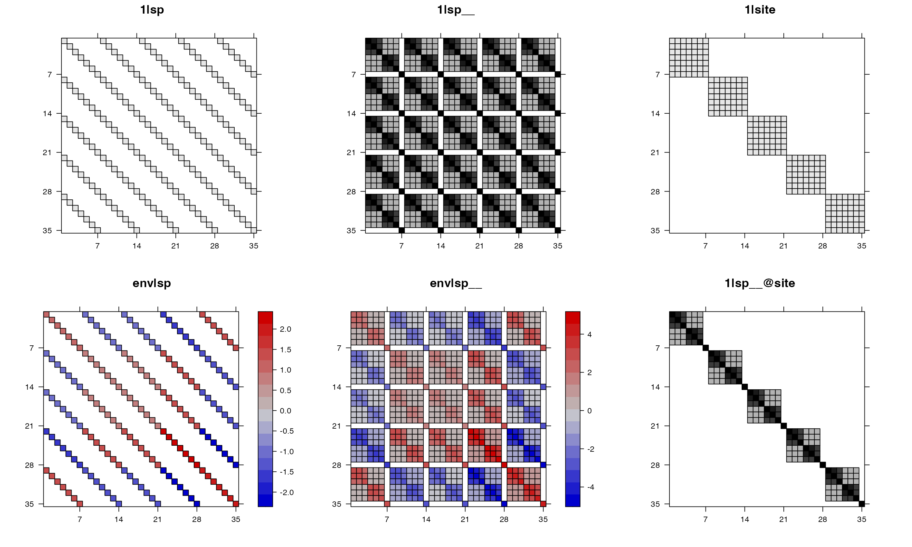

In the above plot, we can see that some of the panels are black-white
but some have colors. This is because, by default, if a matrix has both
positive and negative values, then the function will use red-blue color
and will draw a key for that (use `colorkey = FALSE` to suppress it). If
a matrix does not have negative values, then the function will use
black/white color (use `useAbs = FALSE` to use color instead, and use
`colorkey = FALSE` to suppress key if wanted). In both cases, value 0
will be white so that the structure of the var-cov matrix can be easier
to see.

``` r

# all use color with useAbs = FALSE
pglmm_plot_re(Y ~ 1 + env + (1|sp__) + (1|site) + (env|sp__) + (1|sp__@site),
              data = d, cov_ranef = list(sp = phy), show.image = TRUE, 
              show.sim.image = FALSE, useAbs = FALSE)
```

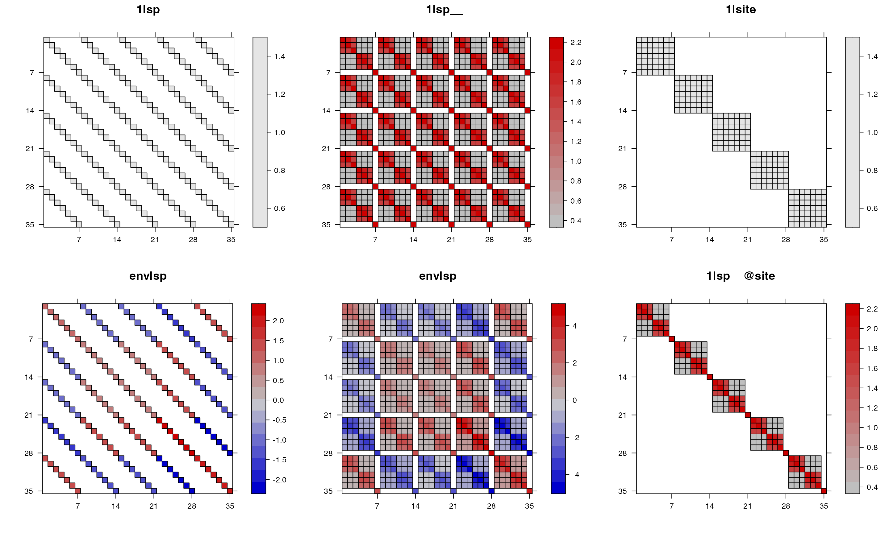

For the above plot, notice that for `1|sp` and `1|site`, all values are
either 1 or 0 even though we have a range in the key. We can suppress
the key with `colorkey = FALSE`.

``` r

# suppress key with colorkey = FALSE
pglmm_plot_re(Y ~ 1 + env + (1|sp__) + (1|site) + (env|sp__) + (1|sp__@site),
              data = d, cov_ranef = list(sp = phy), show.image = TRUE, 
              show.sim.image = FALSE, useAbs = FALSE, colorkey = FALSE)
```

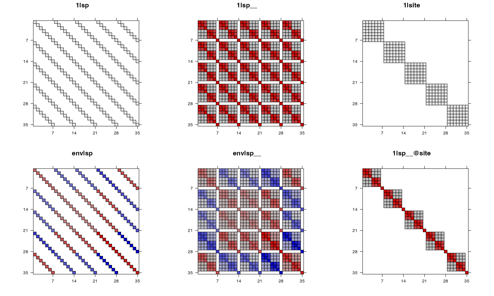

We can also just use `colorkey = FALSE` and still use black/white color
for matrices that do not have negative values (without setting
`useAbs`).

``` r

# suppress colorkey, let the function decide whether use color or not
pglmm_plot_re(Y ~ 1 + env + (1|sp__) + (1|site) + (env|sp__) + (1|sp__@site),
              data = d, cov_ranef = list(sp = phy), show.image = TRUE, 
              show.sim.image = FALSE, colorkey = FALSE)
```

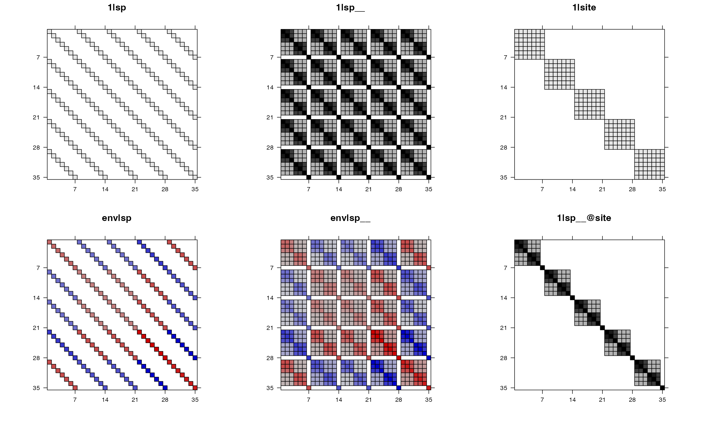

To make all plots black or white, use `useAbs = TRUE`.

``` r

# all black and white
pglmm_plot_re(Y ~ 1 + env + (1|sp__) + (1|site) + (env|sp__) + (1|sp__@site),
              data = d, cov_ranef = list(sp = phy), show.image = TRUE, 
              show.sim.image = FALSE, useAbs = TRUE)
```

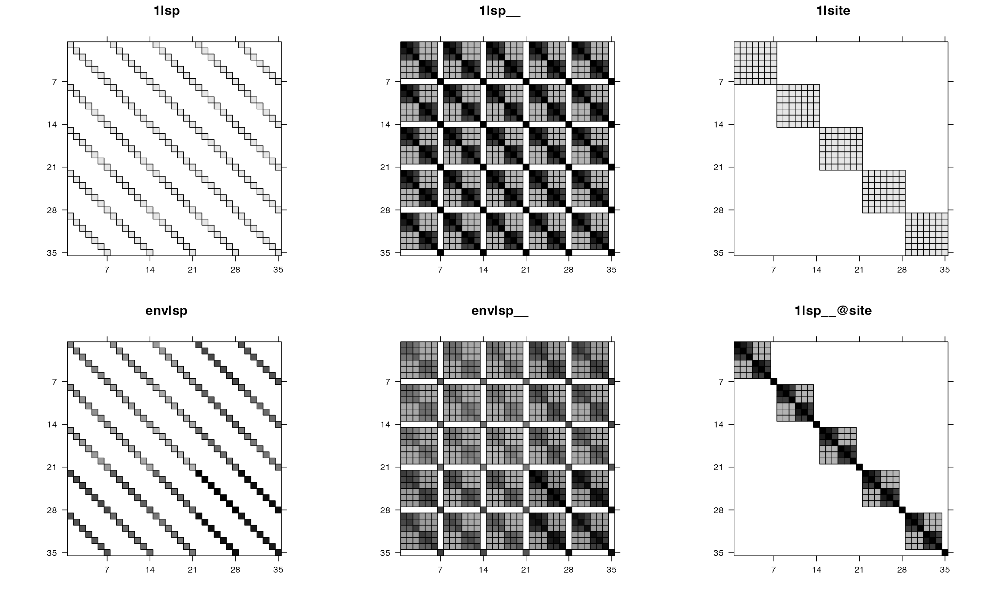

### Individual plots for var-cov matrices

Instead of plotting all var-cov matrices in one figure, we can also
select the ones we are interested and then work from there.

``` r

names(mod1re)
## [1] "vcv"               "sim"               "tree"             
## [4] "plt_re_list"       "plt_sim_list"      "plt_re_all_in_one"
```

So, the data of var-cov matrices are saved as `mod1re$vcv`, which is a
list. We can use this list to plot the random terms in other ways, using
either the base R or ggplot2 package.

``` r

names(mod1re$vcv)
## [1] "1|sp"        "1|sp__"      "1|site"      "env|sp"      "env|sp__"   
## [6] "1|sp__@site"
```

The individual plots are saved as `mod1re$plt_re_list`, which is also a
list.

``` r

names(mod1re$plt_re_list)
## [1] "1|sp"        "1|sp__"      "1|site"      "env|sp"      "env|sp__"   
## [6] "1|sp__@site"
mod1re$plt_re_list[[6]]
```

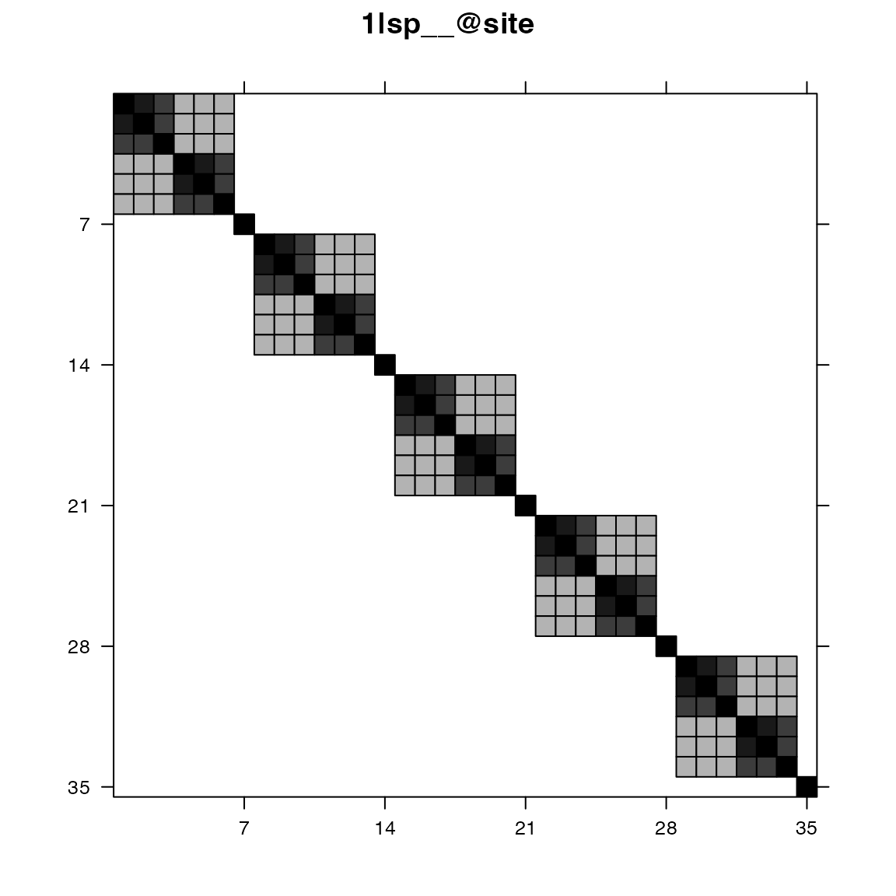

The individual plots were generated using
[`Matrix::image()`](https://rdrr.io/r/graphics/image.html), which used
[`lattice::levelplot()`](https://rdrr.io/pkg/lattice/man/levelplot.html)
as the back bone function.

``` r

Matrix::image(mod1re$vcv[[6]], xlab = "", ylab = "", sub = "", main = "1|sp__@site")
```

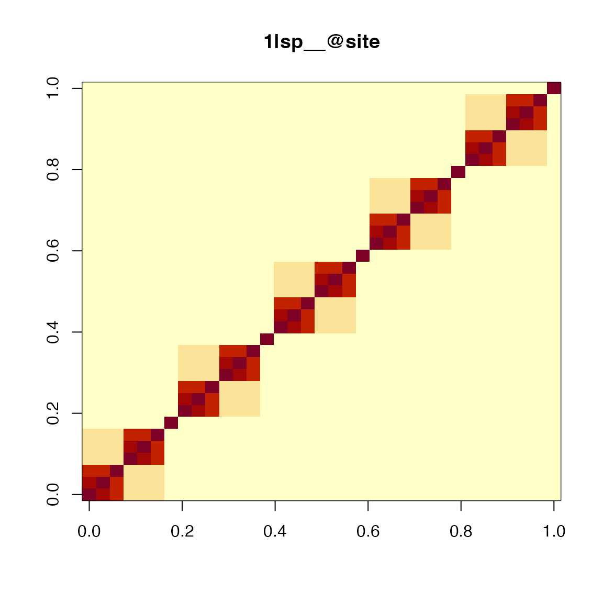

We can also pick the ones that we are interested in and put them in one
figure. For example, suppose that we are only interested in those with
phylogenetic relationships. That is, `1|sp__`, `env|sp__`, and
`1|sp__@site`.

``` r

gridExtra::grid.arrange(grobs = mod1re$plt_re_list[c(2, 5, 6)], nrow = 1)
```

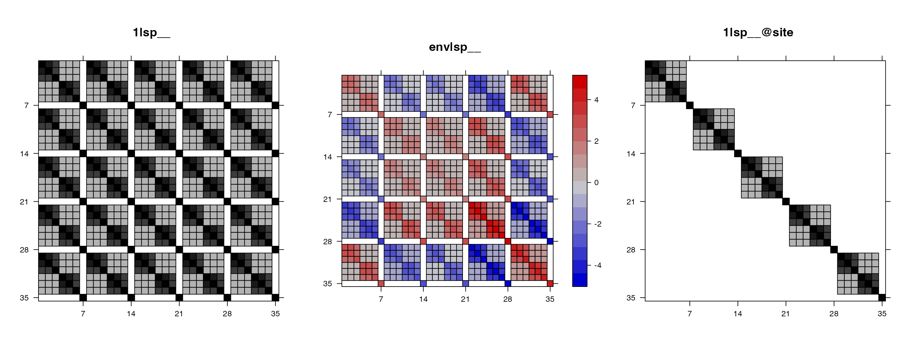

To save this plot, we can wrap the above line of code within
[`pdf()`](https://rdrr.io/r/grDevices/pdf.html) and
[`dev.off()`](https://rdrr.io/r/grDevices/dev.html).

## Simulated site by species matrix for random terms

For each random term, we can simulate some values for all data points.
We can reshape this long format into a site by species matrix. By
plotting this site by species matrix, we can see what does “closely
related species have similar abundance (within or across sites)” mean.

### Plot simulated matrices of all random terms in one figure

``` r

# plot simulated matrices of random terms
mod1sim = pglmm_plot_re(Y ~ 1 + env + (1|sp__) + (1|site) + (env|sp__) + (1|sp__@site),
                        data = d, cov_ranef = list(sp = phy), show.image = FALSE, 
                        show.sim.image = TRUE)
```

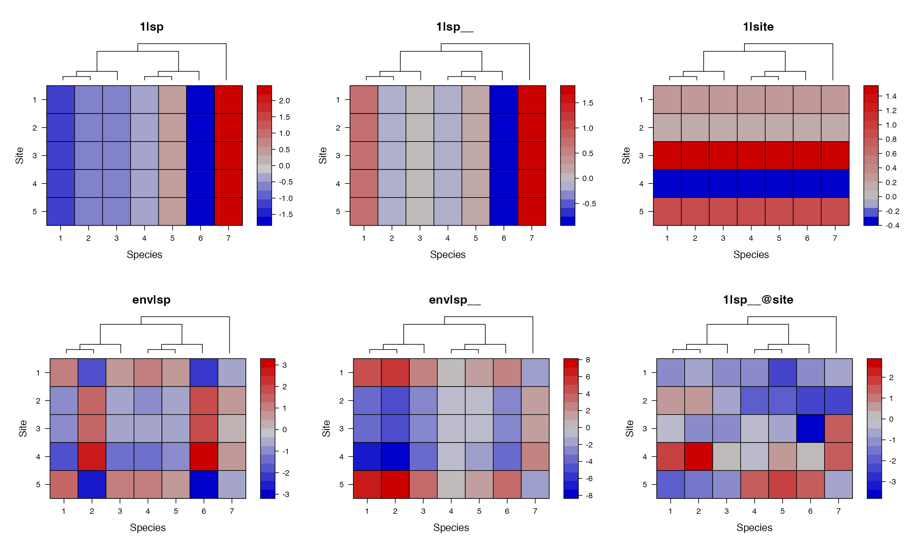

For the `1|sp__` panel, we can see that closely related species have
similar value across all sites. While the \``|sp__@site` panel shows
that closely related species within each site have similar values.

By default, we added a phylogeny for species at the top of each panel
when we show the simulated site by species matrices. This can be
suppressed with `add.tree.sp = FALSE`.

``` r

pglmm_plot_re(Y ~ 1 + env + (1|sp__) + (1|site) + (env|sp__) + (1|sp__@site),
              data = d, cov_ranef = list(sp = phy), show.image = FALSE, 
              show.sim.image = TRUE, add.tree.sp = FALSE)
```

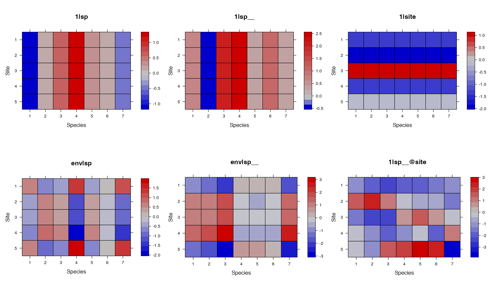

Again, we can remove the keys with `colorkey = FALSE`. We can also use
`useAbs` to force using color for all panels.

``` r

pglmm_plot_re(Y ~ 1 + env + (1|sp__) + (1|site) + (env|sp__) + (1|sp__@site),
              data = d, cov_ranef = list(sp = phy), show.image = FALSE,
              show.sim.image = TRUE, add.tree.sp = TRUE,
              colorkey = FALSE, useAbs = FALSE)
```

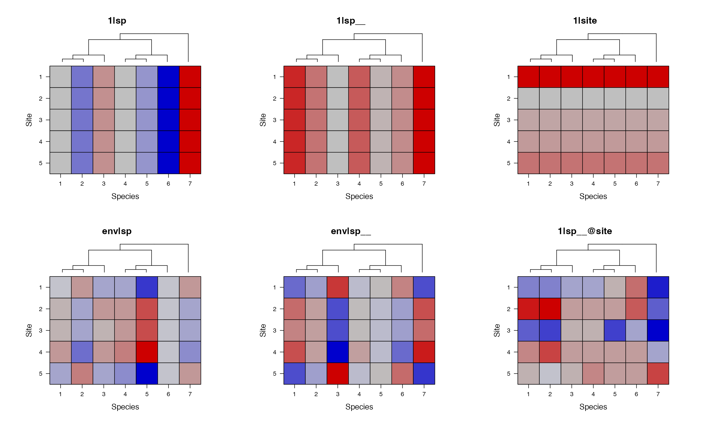

### Individual plots for simulated site by species matrix

``` r

names(mod1sim)
## [1] "vcv"                "sim"                "tree"              
## [4] "plt_re_list"        "plt_sim_list"       "plt_sim_all_in_one"
```

The individual simulated matrices are saved as `mod1sim$sim` and
individual plots are saved as `mod1sim$plt_sim_list`. We can use the
same approach to select our own plots as those of var-cov matrices.

We can control the space between the phylogeny and the matrix plot with
`key.top` argument in
[`lattice::levelplot()`](https://rdrr.io/pkg/lattice/man/levelplot.html),
which has a default value of 1 (line).

``` r

gridExtra::grid.arrange(grobs = mod1sim$plt_sim_list[c(2, 6)], nrow = 1)
```

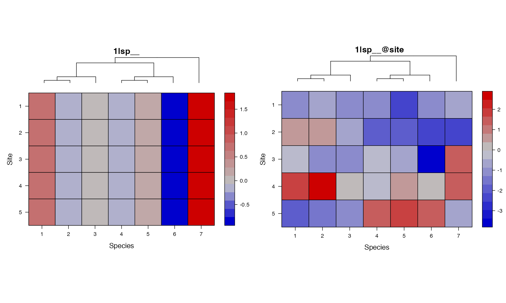

``` r

gridExtra::grid.arrange(grobs = lapply(mod1sim$plt_sim_list[c(2, 6)], 
                                       update, 
                                       par.settings = list(layout.heights = 
                                                             list(key.top = 0.3,
                                                                  main = 5))), 
                        nrow = 1)
```

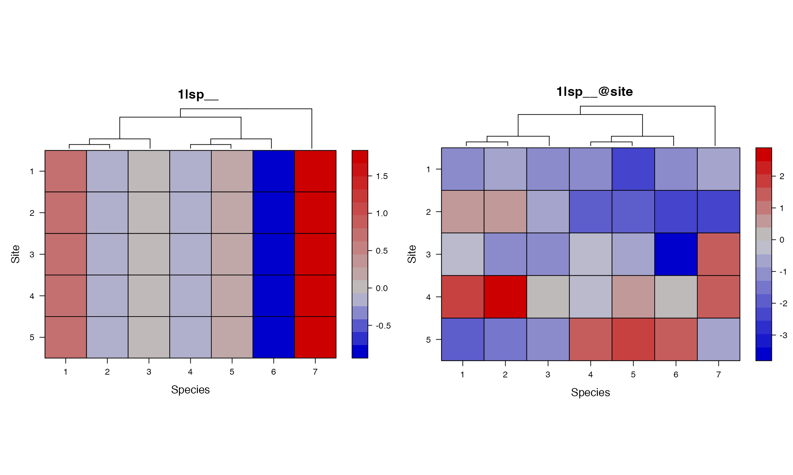

### Fitted model as input

If you don’t have the model fitted, then the above way with specified
formula, data, etc. can save you lots of time. Because it won’t actually
fit the model, instead, it only return and plot the variance-cov
matrices of random terms. However, if you already have the model fitted,
you can just use the model as the input.

``` r

pglmm_plot_re(x = mod_1, show.image = FALSE, show.sim.image = TRUE, 
              add.tree.sp = TRUE, colorkey = FALSE, useAbs = FALSE)
```

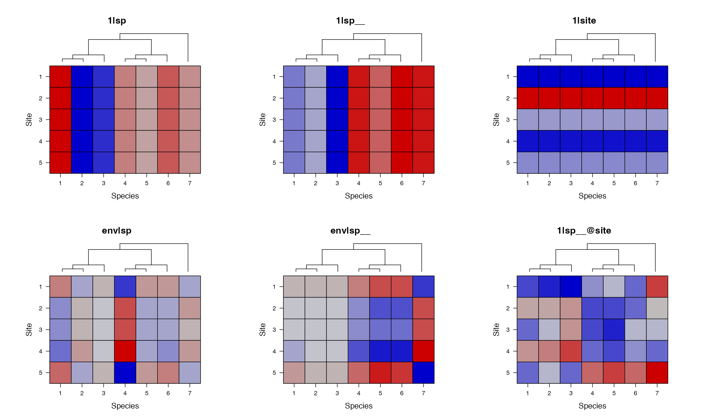

``` r

pglmm_plot_ranef(x = mod_1, show.image = TRUE, show.sim.image = FALSE, useAbs = TRUE)
```


